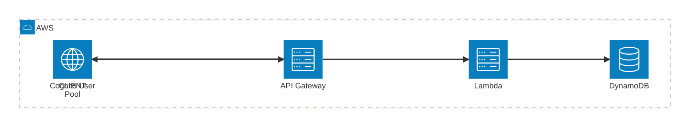

# Workout Tracker

1. [Roadmap](#roadmap)
2. [Ideas](#ideas)
3. [Architecture](#architecture)
4. [Data Design](#data-design)
5. [Self Hosting](#self-hosting)
6. [Notes](#notes-and-other-thoughts-to-keep-in-mind)

# Roadmap

1. Authentication
a. Username and password authentication via **AWS Cognito User Pool** — email is optional and used only for account recovery.
b. A Cognito authorizer on API Gateway ensures per-user data isolation — each request is validated against the user's JWT before any data access.

2. Features
a. record your exercise that you have completed allowing you to add sets reps and weight (with measurement) easily.
    - looking at adding a simple ui to allow this.
    - allow for weight, distance and time measurement
b. record you entire workouts (multiple exercises)
c. save workouts for the user to be able to quickly start a new workout without needing to go through the steps of adding a new exercise each time you do it.
    - Users will be able to save and update the workout then any new recorded workout will use the updated saved workout
d. recording user weight and attaching it to the workout giving the user a view on their weight as they work (optional feature)

3. Payment
a. I won't be able to afford this if the app scales so will want to be able to charge users for the app. I'm thinking £4 per month for a user
b. I want users to be able to experience the app before needing to pay so will need to look into using a system that would allow users to record x number of workouts with x exercises before they need to pay to access the app
    - maybe something like 30 workouts recorded to allow the users time to learn to use the app and maybe become dependent on the app, reads would be free for the users, reading shouldn't be the bottleneck I'm hoping
    - users can only save 3 workouts
    - The freemium limits are enforced via **atomic counters** on the `UserProfiles` table (`workoutsRecorded` and `savedTemplateCount`). These are incremented atomically on each write, so no extra read is needed to check the limit before allowing a write.

# Ideas

1. Trainer integration
- allow trainers to share created workouts with their clients without clients needing to create their own workout.
- allow clients to share their completed workouts with their trainers meaning trainers can see the progress of their client over the long term allowing them to adjust the training schedule based on the progress of their client.
_Note: cross-user queries (e.g. a trainer viewing all of a client's workouts) will be easier to implement after migrating to a relational database where joins and secondary indexes are more natural._

2. Progress chart
- Chart the weight / rep progress of a given exercise

# Architecture

# Data Design

Three tables are used, designed to minimise read/write operations and support the freemium model without extra reads:

| Table | PK | SK | Notes |
|---|---|---|---|
| `UserProfiles` | `userId` | — | Stores user data, subscription status, and atomic freemium counters (`workoutsRecorded`, `savedTemplateCount`) |
| `Workouts` | `userId` | `WORKOUT#<timestamp>#<workoutId>` | Denormalised — exercises and sets stored inline within the item. 1 read retrieves a full workout instead of 1 (workout) + N (exercises) + sets reads. Body weight is logged inline and will be extracted to its own table during a future SQL migration. |
| `SavedTemplates` | `userId` | `TEMPLATE#<templateId>` | Saved workout templates |

**Key design decisions:**
- **Denormalised workout storage** — exercises and sets are embedded directly in the workout item, reducing read amplification (one DynamoDB `GetItem` returns the full workout).
- **Atomic counters** — `workoutsRecorded` and `savedTemplateCount` on `UserProfiles` are incremented using DynamoDB atomic updates on each write, so the freemium limit check requires no extra read.
- **Sort key pattern** — `WORKOUT#<timestamp>#<workoutId>` gives natural reverse-chronological ordering when querying a user's workout history.
- **Future migration path** — because exercises and sets are stored inline, migrating to SQL involves decomposing each workout item into normalised relational tables (`workouts`, `exercises`, `sets`). The denormalised structure maps deterministically to these SQL rows, making the migration mechanical rather than a data-modelling redesign.

# Self hosting

There are terraform files available in the /infra folders, both files are available for both preview and production environments, if you wish to self host the app yourself you can do so on AWS.

## BEFORE YOU CONTINUE

**bare in mind that you will be deploying my code and it is your responsibility to ensure that I am not being a malicious actor, I personally, if asked, would discourage anyone from deploying or running any code they do not understand themselves, deploying and running this code you do so at your own risk**.

## Steps to self hosting

These are the steps required to self host

### AWS IAM role configuration

This is the auth requirements for the Github actions to auto create and auto deploy

1. Create an IAM role with the following policies attached.
[infra/state-policy](./infra/state-policy.md)
[module/api-gateway](./infra/modules/api-gateway/policy.md)
[module/cloudfront](./infra/modules/cloudfront/policy.md)
[module/cognito](./infra/modules/cognito/policy.md)
[module/dns](./infra/modules/dns/policy.md)
[module/dynamodb](./infra/modules/dynamodb/policy.md)
[module/lambda](./infra/modules/lambda/policy.md)
[module/resource-group](./infra/modules/resource-group/policy.md)
[module/s3](./infra/modules/s3/policy.md)

[IAM role trust policy](./infra/trust-policy.md)

2. Clone this repository to your own github account

3. Add necessary secrets to your github actions secrets

required:
`AWS_WORKOUT_TRACKER_CI_ROLE`: The AWS IAM role that you set up in step 1

optional:
`AWS_REGION`: The AWS region that you'd like to deploy to (defaults to `eu-west-2` which is London)
`DOMAIN_CERTIFICATE_ARN`: The AWS ARN for the certificate for your domain
`ROUTE53_ZONE_ID`: The ZoneID for the route53 hosted zone for you domain

# Notes and other thoughts to keep in mind
- **Cost efficiency** — at low usage, DynamoDB on-demand + Lambda free tier + Cognito free tier means the app runs for effectively $0/mo, making it ideal for the early stages of the project.
- **Future migration path** — as the app scales and fixed infrastructure costs become justifiable, the plan is to migrate from DynamoDB to PostgreSQL or self-hosted PocketBase (Hetzner). The denormalised DynamoDB design is intentionally structured so each item maps cleanly to SQL rows, keeping this migration straightforward.
- **Horizontal scaling** — DynamoDB on-demand mode handles burst writes natively without any additional queuing infrastructure, removing the need for SQS write queuing at this scale.

